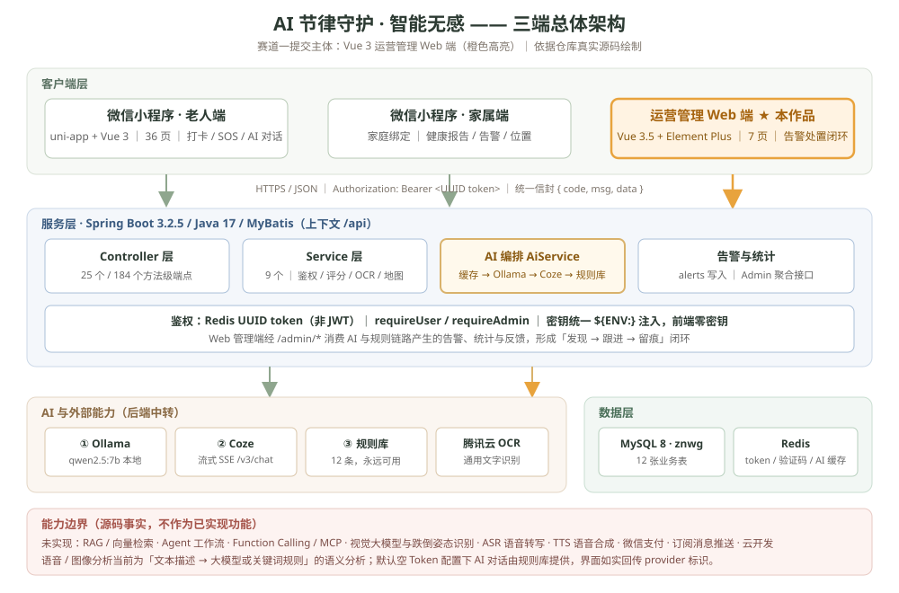

# AI 节律守护 · 智能无感 —— 运营管理 Web 端技术文档

> 第九届传智杯全国大学生数智创新与 AI 应用大赛 · 赛道一「AI WEB 网页开发」
> 文档版本：v1.0 ｜ 编制日期：2026-11-15 ｜ 对应源码：`guardian-admin` + `guardian-server`
>
> **编制原则**：本文档所有功能描述、数字、代码片段均取自仓库实际源码，未实现的能力一律在「第 4.6 节 能力边界」中明示，不作为已交付功能陈述。

---

## 目 录

| 章 | 内容 | 对应赛题要求 |
|---|---|---|
| 1 | 项目概述 | 项目概述 |
| 2 | 需求分析 | 需求分析 |
| 3 | 系统架构设计 | 系统架构设计（含架构图） |
| 4 | AI 技术方案 | **技术选型理由 / 集成方式 / 优化策略** |
| 5 | 核心功能实现 | 关键代码 |
| 6 | 测试与部署 | 测试记录 |
| 7 | 总结与展望 | 总结与展望 |
| 附 A | 创新点说明 | **技术创新点 + 应用创新点** |
| 附 B | 源码事实核对表 | 数字口径与实现边界 |

---

# 第 1 章 项目概述

## 1.1 作品定位

**「AI 节律守护 · 智能无感」运营管理 Web 端**（工程名 `guardian-admin`）是一套面向社区养老服务机构、家属协作方的桌面端运营工作台。它与微信小程序端、Spring Boot 后端共同构成一套面向独居/空巢老人的健康守护系统。

三端分工如下：

| 端 | 技术形态 | 使用者 | 职责 |
|---|---|---|---|
| 微信小程序端 | uni-app + Vue 3（36 页） | 老人、家属 | 日常打卡、SOS 求助、AI 对话、健康记录 |
| **运营管理 Web 端（本作品）** | **Vue 3 + TypeScript + Element Plus（7 页）** | **机构运营人员、管理员** | **数据总览、告警处置、用户与设备管理、反馈闭环、系统监控** |
| 服务端 | Spring Boot 3.2.5（25 个 Controller） | — | 业务接口、AI 编排、数据持久化 |

本作品在赛道一提交的是**以 Web 应用为主要呈现形态的运营管理端**：浏览器直接访问，采用桌面端侧边导航 + 多栏数据布局，具备完整的登录鉴权、路由守卫、数据可视化与后台业务闭环。

## 1.2 为什么把 Web 端定位为「AI 守护运营工作台」

老年健康守护的真实难点不在「有没有 AI 对话」，而在**异常发生后有没有人处理**。一条跌倒或心率异常告警如果只推送到手机上、无人跟进，守护链条就是断的。

因此本 Web 端承担的是 AI 链路的**最后一公里**：

```
老人端产生数据 / 异常
      ↓
后端 AI 编排（大模型 / 规则库）分析并写入 alerts 表
      ↓
【本 Web 端】运营人员在告警处置页看到 → 填写处理说明 → 状态闭环
      ↓
数据总览页统计趋势 → 反馈处理页收集意见 → 形成运营闭环
```

> **诚实声明**：Web 管理端自身不直接调用大模型接口，AI 推理集中在后端 `AiService`。Web 端消费的是 AI 与业务规则产生的**结构化结果**（告警、统计、反馈）。这一分工在第 3、4 章有完整说明，避免把后台能力误写为前端能力。

## 1.3 项目规模（源码实测口径）

| 指标 | 实测值 | 获取方式 |
|---|---|---|
| Web 端页面 | 7 个 `.vue` 视图 / 1,169 行 | `src/views/` 文件统计 |
| Web 端路由 | 8 条（含兜底重定向） | `src/router/index.ts` |
| 后端 Java 文件 | 67 个 / 17,565 行 | `find src -name "*.java"` |
| 后端 Controller | 25 个 | `controller/` 目录 |
| 后端方法级接口 | 184 个 | 方法级映射注解统计（另有 23 个类级 `@RequestMapping`） |
| 数据库表 | 12 张 | `db/V1__init_schema.sql` |
| 小程序页面 | 36 个 / 19,976 行 | `src/pages/` 文件统计 |

> 项目历史文档中曾出现「22 个 Controller / 153 个接口」「9 个视图」「14,732 行」等数字，均为旧版本或估算值，本文档统一采用上述实测口径。

---

# 第 2 章 需求分析

## 2.1 目标用户与痛点

| 角色 | 工作场景 | 痛点 | Web 端对应功能 |
|---|---|---|---|
| 社区/养老机构运营人员 | 每日查看所辖老人状态、处置异常 | 告警散落在手机通知里，无法批量筛选、无法留痕 | 告警处置页（按状态/级别筛选 + 填写处理说明） |
| 系统管理员 | 维护账号、角色、设备 | 缺少统一管理平台，只能改数据库 | 用户管理页（设管理员、启停用、详情）、设备管理页 |
| 运营负责人 | 汇报服务量、趋势 | 数据靠人工汇总 | 数据总览页（指标卡 + 7/14/30 天趋势图） |
| 客服/产品 | 收集并回复意见 | 反馈无闭环 | 反馈处理页（列表 + 回复） |
| 运维 | 确认服务可用 | 后端 / 数据库 / 缓存状态不可见 | 系统监控页（MySQL、Redis、JVM 指标，30 秒刷新） |

## 2.2 功能性需求

| 编号 | 需求 | 优先级 | 实现页面 |
|---|---|---|---|
| R1 | 管理员凭手机号 + 6 位验证码登录，非管理员不得进入 | P0 | `Login.vue` |
| R2 | 未登录访问任意页面自动跳转登录页并带回跳地址 | P0 | 路由守卫 |
| R3 | 一屏查看用户数、告警数、反馈数等指标 | P0 | `Dashboard.vue` |
| R4 | 查看近 7/14/30 天双线趋势 | P1 | `Dashboard.vue` + ECharts |
| R5 | 用户检索、设为管理员、禁用/启用、查看详情 | P0 | `Users.vue` |
| R6 | 告警按状态/级别筛选、填写处理说明形成闭环 | P0 | `Alerts.vue` |
| R7 | 用户反馈列表与回复 | P1 | `Feedback.vue` |
| R8 | 设备列表与所属用户 | P1 | `Devices.vue` |
| R9 | MySQL / Redis 连通性与 JVM 运行时指标 | P1 | `System.vue` |

## 2.3 非功能性需求

| 类别 | 要求 | 实现方式 |
|---|---|---|
| 安全 | 前端不持有任何 AI / 云服务密钥 | 全部密钥由后端 `${ENV:}` 注入；前端只持会话 token |
| 安全 | 会话可失效、越权可拦截 | 后端 Redis token 校验 + `requireAdmin`；前端 401/403 拦截 |
| 健壮性 | 后端异常时不向用户暴露堆栈 | axios 响应拦截统一提示 |
| 可维护性 | 前后端字段差异可适配 | `src/api/index.ts` 字段适配层 |
| 适老化延伸 | 界面克制、字号与对比度统一 | 设计令牌（主色 `#8FA68E`、暖米底 `#F4EFE6`、12px 圆角） |

---

# 第 3 章 系统架构设计

## 3.1 总体架构



<div style="font-size:0.85em;color:#666">图 3-1　「AI 节律守护 · 智能无感」三端总体架构（Web 管理端为本赛道提交主体）</div>

## 3.2 分层说明

| 层 | 技术 | 关键文件 | 职责 |
|---|---|---|---|
| 表现层 | Vue 3.5 + vue-router 4 + Element Plus 2.14 | `src/views/`、`src/layouts/AdminLayout.vue` | 7 个页面、侧边导航、表单与表格 |
| 状态层 | Pinia 2.2 | `src/stores/user.ts` | token / user / isAdmin，持久化 `localStorage` |
| 请求层 | axios 1.20 | `src/api/index.ts` | `baseURL: '/api'`、30s 超时、Bearer 注入、统一信封解析、字段适配 |
| 可视化层 | ECharts 6.1 | `Dashboard.vue` | 指标趋势折线图（渐变填充） |
| 构建层 | Vite 8.3 + TypeScript 6.0 | `vite.config.ts` | 端口 5177，`/api` 代理至 `http://localhost:3000` |
| 服务层 | Spring Boot 3.2.5 / Java 17 / MyBatis 3.0.3 | `guardian-server` | 25 个 Controller、9 个 Service、11 个 Mapper |
| AI 层 | Ollama / Coze / 本地规则库 | `ai/AiService.java`、`ai/LocalRuleProvider.java` | 三层降级编排、上下文注入、Redis 缓存 |
| 数据层 | MySQL 8（库 `znwg`）+ Redis | `db/V1__init_schema.sql` | 12 张业务表、验证码/token/AI 响应缓存 |

## 3.3 前端工程结构

```
guardian-admin/
├── package.json                 # Vue 3.5 / Vite 8.3 / TS 6.0 / Element Plus 2.14
├── vite.config.ts               # 端口 5177；/api → localhost:3000
├── src/
│   ├── main.ts                  # Element Plus 全量注册
│   ├── router/index.ts          # 8 条路由 + beforeEach 登录守卫
│   ├── layouts/AdminLayout.vue  # 侧边栏 + 顶栏
│   ├── stores/user.ts           # Pinia 用户态，localStorage 持久化
│   ├── api/index.ts             # axios 实例 + 18 个接口模块 + 字段适配层
│   └── views/                   # 7 个页面
│       ├── Login.vue            # 验证码登录（60s 倒计时，isAdmin 校验）
│       ├── Dashboard.vue        # 指标卡 + ECharts 趋势
│       ├── Users.vue            # 用户管理
│       ├── Alerts.vue           # 告警处置
│       ├── Feedback.vue         # 反馈回复
│       ├── Devices.vue          # 设备管理
│       └── System.vue           # 系统监控
```

> 说明：项目早期文档曾描述 `server/index.mjs` Express Mock 服务与 pnpm 脚本，当前代码中 **`server/` 目录已不存在、无 pnpm 配置**，`vite.config.ts` 第 8–12 行明确注释「不再使用自带 Mock 服务器，改为代理真实 Spring Boot 后端」。本文档以当前代码为准。

## 3.4 鉴权与数据流

**真实鉴权机制不是 JWT。** 后端 `AuthService` 签发的是随机 UUID token，存于 Redis `guardian:token:<token> → userId`，有效期 7 天；`requireUser(token)` 从 Redis 反查，`requireAdmin` 校验 `users.is_admin`。`application.yml` 中虽保留了 `guardian.jwt.*` 配置项，但 Java 源码中**无任何 JWT 使用代码**，也无 Spring Security 依赖或拦截器。

```
登录：手机号 → POST /api/auth/send-code → 验证码存 Redis（60s 限频）
      → POST /api/auth/login → 返回 UUID token
      → Pinia 存 localStorage（guardian_admin_token / guardian_admin_user）
请求：axios 拦截器注入 Authorization: Bearer <token>
      → 后端 Controller 手动 requireUser / requireAdmin
      → 统一响应信封 { code, msg, data }（HTTP 恒 200，成功判定 code===200）
异常：401 清 token 跳登录；403 提示无权限
```

## 3.5 技术选型理由

| 选型 | 理由（结合本项目实际） |
|---|---|
| Vue 3 + TypeScript | 7 个页面以表格/表单/图表为主，组合式 API + 类型约束降低字段适配层出错率 |
| Element Plus | 后台管理场景需要成熟的表格、分页、弹窗、表单校验组件，避免自研成本 |
| ECharts 6.1 | 趋势图需要渐变、双线、时间区间切换，自绘 SVG 成本高于引入成熟库 |
| Pinia | 仅需维护 token 与用户角色，轻量状态容器足够，无需 Redux 类方案 |
| Vite 代理 `/api` | 开发期前后端同源，规避跨域；生产由 Nginx 反代同路径 |
| 后端仅作 AI 接入层 | 符合赛题「后端服务仅作为 AI 能力的接入层」定位，前端独立可部署 |

---

# 第 4 章 AI 技术方案

> 本章对应赛题「技术选型理由、集成方式、优化策略」三项必含内容，也是评分权重最高的一章。
> 本章所有代码均摘自仓库 `guardian-server/src/main/java/com/guardian/ai/AiService.java` 等真实文件。

## 4.1 AI 能力总体设计

本系统的 AI 能力采用**后端集中编排、多端共享消费**的设计。Web 管理端不重复造 AI 轮子，而是通过后端统一入口获得三类结果：告警记录、健康统计、AI 分析留痕。

核心编排器 `AiService.chat()` 的处理顺序为：

```
Redis 缓存查询（命中直接返回 provider=cache）
      ↓ 未命中
① Ollama 本地模型 qwen2.5:7b      —— 零 API 成本、数据不出本地
      ↓ 关闭 / 失败 / 超时
② Coze 云端智能体（流式 SSE）      —— 能力强，需 Token
      ↓ 未配置 / 失败 / 4100 认证失败
③ 本地规则库（12 条关键词规则）    —— 永远可用、零延迟
      ↓
返回 ChatResult（含 provider 标识，便于前端与运维区分来源）
```

## 4.2 技术选型理由

| 候选方案 | 最终选择 | 理由 |
|---|---|---|
| 单一云端大模型 API | ❌ 未采用 | 网络抖动或额度耗尽会让老年用户直接看到报错；本项目要求「永不报错」 |
| 仅本地小模型 | ❌ 未采用 | 复杂健康问询回答质量不足，且部署门槛高 |
| 仅规则库 | ❌ 未采用 | 覆盖面窄，无法处理开放域提问 |
| **三层降级（本地 → 云端 → 规则）** | ✅ **采用** | 成本从低到高、能力从弱到强、可用性逐层兜底；任一层失败自动切换 |
| 前端直连大模型 | ❌ 未采用 | 密钥会编译进前端产物，存在反编译泄露风险（原项目即因此产生 5 类泄露点） |
| **后端中转 + 环境变量注入** | ✅ **采用** | 前端零密钥，`application.yml` 全部 `${ENV:}` 占位，`.env.example` 为空值模板 |

## 4.3 集成方式（真实代码）

### 4.3.1 三层降级主入口

`guardian-server/src/main/java/com/guardian/ai/AiService.java` 第 113–151 行：

```java
// ---------- ① Ollama ----------
if (ollamaEnabled) {
    try {
        String reply = callOllama(text, ctx);
        if (StrUtil.isNotBlank(reply)) {
            cache(cacheKey, reply);
            return ChatResult.of(reply, conversationId, "ollama", start);
        }
    } catch (Exception e) {
        log.warn("[AI] Ollama 失败，降级到 Coze: {}", e.getMessage());
    }
}

// ---------- ② Coze ----------
if (cozeEnabled && StrUtil.isNotBlank(cozeToken) && StrUtil.isNotBlank(cozeBotId)) {
    try {
        String reply = callCoze(text, conversationId, ctx);
        if (StrUtil.isNotBlank(reply)) {
            cache(cacheKey, reply);
            return ChatResult.of(reply, conversationId, "coze", start);
        }
    } catch (Exception e) {
        log.warn("[AI] Coze 失败，降级到规则库: {}", e.getMessage());
    }
}

// ---------- ③ 规则库兜底 ----------
String reply = ruleProvider.reply(text, ctx == null ? AiContext.empty() : ctx);
cache(cacheKey, reply);
return ChatResult.of(reply, conversationId, "rule", start);
```

### 4.3.2 Coze 流式调用与密钥后端中转

同文件第 202–222 行：

```java
private String callCoze(String message, String conversationId, AiContext ctx) throws Exception {
    JSONObject body = new JSONObject();
    body.set("bot_id", cozeBotId);
    body.set("user_id", "guardian-user");
    body.set("stream", true);
    body.set("auto_save_history", true);
    body.set("additional_messages", new Object[]{
            Map.of("role", "user", "content", buildPrompt(message, ctx), "content_type", "text")
    });
    HttpRequest chatReq = HttpRequest.newBuilder()
            .uri(URI.create(cozeBaseUrl + "/v3/chat"))
            .timeout(Duration.ofSeconds(cozeTimeout))
            .header("Authorization", "Bearer " + cozeToken)
            .header("Content-Type", "application/json")
            .header("Accept", "text/event-stream")
            .POST(HttpRequest.BodyPublishers.ofString(body.toString(), StandardCharsets.UTF_8))
            .build();
```

密钥来自 `@Value("${guardian.ai.coze.api-token:}")` 等环境变量占位，**前端与 Web 管理端均不持有任何 AI 密钥**。

### 4.3.3 健康数据上下文注入

`AiService.buildPrompt()`（第 316–329 行）把健康评分、步数、睡眠、服药、位置等结构化数据拼入 prompt 前缀，使回答基于本系统真实数据而非泛泛而谈：

```java
private String buildPrompt(String message, AiContext ctx) {
    // 将健康评分 / 步数 / 睡眠 / 服药 / 位置等上下文拼为文本前缀
    // 再拼接用户本轮提问，交给 Ollama 或 Coze
    ...
}
```

> 该设计是**上下文注入（Context Injection）**，不是 RAG：源码中不存在 embedding、向量库或检索模块，请勿在答辩中表述为检索增强生成。

### 4.3.4 规则库兜底

`ai/LocalRuleProvider.java` 定义 12 条关键词规则（问候、健康、步数、睡眠、用药、情绪、饮食、位置、SOS、家人、感谢、告别），命中即由规则构造函数结合 `AiContext` 生成回复；全部未命中则返回默认回复。规则执行本身也包在 try/catch 中，单条规则异常不会导致整体失败。

## 4.4 优化策略

| 策略 | 实现 | 效果 |
|---|---|---|
| 响应缓存 | Redis 缓存 AI 回复，TTL 300 秒（`AiService` 第 99–111、331–341 行） | 相同问题不再重复调用模型，降低延迟与成本 |
| 低成本优先 | 默认先走 Ollama，再走 Coze | 成本从零到有，最坏情况下才产生 API 费用 |
| 超时与快速失败 | Coze 请求设置 `Duration.ofSeconds(cozeTimeout)`；Ollama/Coze 各自 try/catch | 单层卡顿不拖垮整体链路 |
| 可观测降级 | `ChatResult.provider` 返回 `ollama/coze/rule/cache` | 运维与评审可直接看到当前由哪一层提供服务 |
| 前端不假装成功 | 请求失败时展示明确提示，不伪造 AI 回复 | 避免误导用户，属于负责任 AI 设计 |
| 配额保护 | 腾讯云 OCR 每人每日 20 次 / 全局 500 次 Redis 配额 | 防止第三方识别服务被刷爆 |
| 密钥安全 | 环境变量注入 + `.gitignore` 排除 `.env` + 空值 `.env.example` | 前端零密钥，仓库无明文密钥 |

## 4.5 AI 与 Web 管理端的连接点

| Web 页面 | 消费的数据 | 数据来自 AI / 规则链路的方式 |
|---|---|---|
| 告警处置 `Alerts.vue` | `alerts` 表记录 | 后端 `/monitor/text-analyze`、`/analyze-frame`、`/fall-detect` 等分析接口写入告警；运营人员在此筛选并填写处理说明 |
| 数据总览 `Dashboard.vue` | 用户数、告警数、反馈数、趋势 | `AdminController` 的 `/admin/dashboard`、`/admin/trend` 聚合统计 |
| 反馈处理 `Feedback.vue` | 用户反馈 | `/admin/feedback`、`/admin/feedback/reply` 闭环 |
| 系统监控 `System.vue` | MySQL / Redis / JVM 状态 | Redis 既是缓存也是 AI 链路依赖，监控页可直接观察其可用性 |

## 4.6 能力边界（诚实声明）

**以下能力在本版本源码中未实现或仅为占位，本文档不将其计为已交付功能：**

| 能力 | 真实状态 | 依据 |
|---|---|---|
| RAG / 向量检索 / 知识库 | 未实现 | 全库无 embedding、vector、知识库代码 |
| Agent 工作流 / Function Calling / MCP | 未实现 | 无工具编排或函数调用框架 |
| 视觉大模型、跌倒姿态识别（CV） | 未实现 | `MonitorController` 第 48–50、124–126 行注释明确「没有视觉模型接入」；当前是「画面描述文本 → 大模型/关键词」的语义分析 |
| ASR 语音转写、TTS 语音合成 | 未实现 / 占位 | 前端录音后丢弃音频、传固定模板文字；`/ai/tts` 返回 `available=false` |
| 微信支付、订阅消息推送、云开发 | 未实现 | 仅有配置项或待办说明，无调用代码 |
| 真实天气数据 | 模拟值 | `WeatherController` 响应带 `mock:true` |

**默认配置提醒**：`application.yml` 中 `ollama.enabled` 默认 `false`，`COZE_API_TOKEN` / `COZE_BOT_ID` 默认为空；`AiService.chat()` 会跳过前两层，实际由规则库提供回复。**演示前需注入 Coze Token 或启动 Ollama，否则 AI 对话将呈现为规则库回复**（界面会如实显示 `provider=rule`）。

## 4.7 AI 安全与可控性

1. **密钥不下发**：所有 AI / 云服务调用经后端中转，前端产物不含任何 Token。
2. **不替代医疗诊断**：AI 回复用于健康建议与陪伴，不作为诊断结论。
3. **可控降级**：任何外部 AI 不可用，系统仍能提供确定性回复，不出现空白页或技术报错。
4. **数据最小化**：上下文注入仅使用守护必需的健康指标。
5. **审计可追溯**：`provider` 标识、缓存键、降级日志均留在后端，便于复盘。

## 4.8 后续演进路线（不作为本次交付）

| 优先级 | 计划 | 对应赛题考察点 |
|---|---|---|
| P0 | 补齐 ASR / TTS，替换语音与图像链路的模板文字 | 多模态能力 |
| P1 | 引入健康知识库检索增强 | RAG |
| P1 | 把统计/告警接口封装为工具供模型调用 | Function Calling |
| P2 | 用工作流编排「感知 → 分析 → 告警 → 跟进」 | Agent 工作流 |

> 上表是**规划**，不是已完成功能。把它写出来是为了说明团队对技术方向有清晰判断，同时避免评审时把规划误认为现状。

---

# 第 5 章 核心功能实现

## 5.1 登录与路由守卫

`Login.vue` 实现手机号 + 6 位验证码、60 秒倒计时，并在登录成功后校验 `isAdmin`。`router/index.ts` 第 65–85 行的全局守卫：

```ts
router.beforeEach((to) => {
  const user = useUserStore()
  if (to.meta.public) return true
  if (!user.isLoggedIn) return { name: 'login', query: { redirect: to.fullPath } }
  if (!user.isAdmin) { user.logout(); return { name: 'login' } }
  return true
})
```

非管理员即使拿到 token 也会被登出并踢回登录页，形成前端 + 后端 `requireAdmin` 的双重校验。

## 5.2 数据总览与趋势图

`Dashboard.vue` 用 7 个指标卡展示用户、告警、反馈等概况，并用 ECharts 绘制近 7/14/30 天双线趋势（支持渐变填充）。区间切换触发 `dashboardApi.trend` 重新拉取，避免前端伪造数据。

## 5.3 告警处置闭环（与 AI 链路的连接点）

`Alerts.vue` 提供按状态/级别筛选与处理说明填写，调用 `alertApi.list` / `alertApi.handle`。这是本系统中「AI 发现异常 → 人工跟进 → 留痕」闭环的落点。

后端 `/monitor/analyze-frame` 的真实判定逻辑（`MonitorController` 第 118–151 行）说明告警来源：

```java
/**
 * ★ 真正的图像识别不在本服务做（没有视觉模型接入），
 *   接口接收「画面描述」文本，据此判断风险并给出建议。
 *   同时检测描述中是否包含跌倒特征词，命中则自动产生 fall 告警。
 */
@PostMapping("/analyze-frame")
public ApiResponse<Map<String, Object>> analyzeFrame(HttpServletRequest req,
                                                     @RequestBody Map<String, Object> body) {
    User user = authService.requireUser(token(req));
    String description = ViewUtil.toStr(body == null ? null : body.get("description"));
    String imageBase64 = ViewUtil.toStr(body == null ? null : body.get("imageBase64"));
    if (description == null && imageBase64 == null) {
        throw BizException.badRequest("请提供画面描述（description）或图像数据（imageBase64）");
    }
    ...
}
```

## 5.4 请求层与字段适配层

`src/api/index.ts` 是前端工程质量的主要体现：axios 实例统一 `baseURL: '/api'`、`timeout: 30000`；请求拦截注入 Bearer token；响应拦截按 `code===200` 拆信封，401 清 token、403 提示无权限。

第 119–169 行的**字段适配层**解决前后端字段命名差异（后端 `role` / `list` 分页键 / `registrations` 等映射为前端期望结构），使 7 个页面无需各自处理脏数据。

## 5.5 腾讯云 OCR 与位置服务

后端 `ImageRecognizeService` 接入腾讯云通用 OCR SDK（`GeneralBasicOCR`），先抽字、再把文字交给 `AiService.chat` 生成解释；未配置密钥时返回 `provider=unconfigured` 并跳过。`TencentMapService` 提供逆地理编码、地理编码、POI 周边与本地 Haversine 距离计算。两者均为**真实第三方调用**，与前述「无视觉模型」并不矛盾：OCR 是文字识别服务，不是视觉理解模型。

## 5.6 数据库设计

`db/V1__init_schema.sql` 建立 12 张表：`users`、`checkin_records`、`health_check`、`devices`、`alerts`、`diet_records`、`elder_info`、`medicine_reminders`、`monitor_data`、`exercise_records`、`family_bindings`、`medicine_records`；含 2 个演示用户（`13800000001` 张爷爷 / `13800000002` 张小明）及健康档案、绑定关系、用药提醒初始化数据。

---

# 第 6 章 测试与部署

> **重要**：本章提供的是**可复现的测试用例与部署步骤**，不是已执行完成的测试报告。截至编制日期，本副本未安装依赖、未启动服务，因此不填写任何「测试通过 ✅」结论。团队在实机执行后，将「实际结果」列补全再提交，避免提交不实测试记录。

## 6.1 环境要求

| 组件 | 版本 | 备注 |
|---|---|---|
| JDK | 17（`pom.xml` 固定 `release=17`） | `start.bat` 内 JDK 路径为开发机绝对路径，换机器需修改 |
| Node.js | ≥ 20（Vite 8 / TS 6） | `package-lock.json` 已提供 |
| MySQL | 8.x，库名 `znwg` | 执行 `db/V1__init_schema.sql` |
| Redis | 7.x | 验证码、token、AI 响应缓存 |
| 可选 | Ollama（`qwen2.5:7b`）或 Coze Token | 不配置则 AI 走规则库 |

## 6.2 部署步骤

```bash
# ① 后端
cd 转换-Java后端/guardian-server
cp .env.example .env          # 填入 MySQL/Redis/Coze 等实际值；切勿提交 .env
# Windows 可用 start.bat（检查 MySQL/Redis → 建库建表 → javac --release 17 编译 → 启动）
# 或：mvn spring-boot:run
# 健康检查：GET http://localhost:3000/api/health/ping

# ② Web 管理端
cd 智能无感-后台管理-Vue项目/guardian-admin
npm ci
npm run dev                   # http://localhost:5177，/api 代理到 3000

# ③ 生产构建
npm run build                 # vue-tsc -b && vite build，产物 dist/
# Nginx 将 / 指向 dist/，/api 反代至后端
```

## 6.3 测试用表（待实机执行后填写）

| # | 测试项 | 步骤 | 预期结果 | 实际结果 | 结论 |
|---|---|---|---|---|---|
| T1 | 验证码登录 | 输入 `13800000001` → 获取验证码（dev 模式见后端日志）→ 登录 | 进入 `/dashboard` | 待执行 | — |
| T2 | 非管理员拦截 | 用非 `is_admin` 账号登录 | 自动登出并跳登录页 | 待执行 | — |
| T3 | 未登录跳转 | 直接访问 `/users` | 跳 `/login?redirect=/users` | 待执行 | — |
| T4 | 指标卡加载 | 进入数据总览 | 7 个指标显示真实统计值 | 待执行 | — |
| T5 | 趋势区间切换 | 依次点 7/14/30 天 | 图表重绘、无报错 | 待执行 | — |
| T6 | 告警筛选与处理 | 按状态筛选 → 填写说明提交 | 列表状态更新并可复查 | 待执行 | — |
| T7 | 用户启停用 | 禁用某用户后以其登录 | 登录被拒 | 待执行 | — |
| T8 | 系统监控 | 断开 Redis 后观察监控页 | 状态显示异常 | 待执行 | — |
| T9 | 401 处理 | 手动清除 localStorage token 后请求 | 自动跳登录 | 待执行 | — |
| T10 | AI 三层降级 | 分别关闭 Ollama / 清空 Coze Token 后发起 AI 分析 | 返回 `provider=rule` 且无报错 | 待执行 | — |
| T11 | 密钥检查 | 对构建产物检索 `pat_` / `sk-` / `Bearer ` | 无真实密钥 | 待执行 | — |
| T12 | 构建检查 | `npm run build`、`mvn compile` | 均通过 | 待执行 | — |

## 6.4 已知工程约束

- `start.bat` 硬编码开发机 JDK / MySQL / Redis 绝对路径，跨机器部署需改为环境变量或配置文件。
- 后端 `application.yml` 保留 `guardian.jwt.*` 但未使用，鉴权实际为 Redis UUID token；后续可清理该配置避免误解。
- 后端 `WebConfig` 使用 `allowedOriginPatterns("*")`，生产环境应收紧到具体域名。
- 项目 `README` 中「已验证 8/8 规则用例」为作者自述，`TestRules.java` 实际只有 6 个用例且非 JUnit 测试，不作为自动化测试结论。

---

# 第 7 章 总结与展望

## 7.1 总结

本作品交付了一套可独立部署的 Vue 3 运营管理 Web 应用：7 个页面覆盖登录鉴权、数据总览、用户与设备管理、告警处置、反馈闭环、系统监控；通过 axios 字段适配层与 Spring Boot 后端解耦；通过后端集中式 AI 编排（Ollama → Coze → 规则库）共享智能能力，前端零密钥。

项目最有价值的不是「接了几个大模型」，而是**把不可靠的 AI 变成可用的产品能力**：三层降级保证任何网络与额度条件下用户都拿得到回复；`provider` 标识让降级过程可观测；告警处置页把 AI 结果接入人工闭环，避免「只报警、没人管」。

## 7.2 不足

如第 4.6 节所列，本版本尚未实现 RAG、Agent 工作流、Function Calling、真实视觉理解与 ASR/TTS；Web 管理端自身不直接调用大模型。这些是明确的当前边界，也是后续迭代方向。

## 7.3 展望

按第 4.8 节路线，优先补齐语音真实转写与语音播报，再引入健康知识库检索增强与工具调用；产品侧把 Web 管理端扩展为社区/机构的多租户运营平台，形成「老人端感知 — 后端 AI 分析 — 机构端跟进」的完整服务链路。

---

# 附 A 创新点说明

## A.1 技术创新点

**① 面向可用性优先的三级 AI 降级架构**

多数 AI 应用把大模型当作唯一依赖，服务抖动即功能失效。本项目以「老年用户不能理解技术错误」为约束，设计 缓存 → Ollama → Coze → 规则库 的四级响应链（缓存为可选命中层），每层独立超时与异常隔离，并在结果中回传 `provider`。这使系统在**零 Token、断网、模型超时**等极端条件下仍能给出确定性回复，同时把 API 成本压到最低。

**② AI 密钥后端中转与零密钥前端**

原项目存在 5 类密钥泄露（前端硬编码 Coze Token、地图 Key 等）。重构后所有第三方调用后移到 Spring Boot，配置统一 `${ENV:}` 占位、`.env.example` 空值模板、`.gitignore` 排除 `.env`。这既是安全整改，也是「前端只消费结构化结果」架构正确性的证明。

**③ 健康上下文注入 + 可观测降级**

`buildPrompt()` 把健康评分、步数、睡眠、服药、位置等结构化数据注入 prompt，让回答基于真实业务数据；配合 Redis 响应缓存与 `provider` 标识，形成「数据可用、成本可控、过程可查」的闭环。

**④ 跨端字段适配层**

后端为 Java 命名习惯、前端为 TypeScript 接口，`src/api/index.ts` 用一层适配统一差异，7 个页面无重复脏数据处理逻辑；同时收敛 401/403 处理，降低越权风险。

## A.2 应用创新点

**① 把「AI 告警」接进人工处置闭环**

AI 分析产生的告警不是终点。Web 管理端提供按状态/级别筛选、填写处理说明、状态留痕，让社区/机构运营人员能真正跟进。这解决了适老化产品「只推送、无闭环」的常见失效模式。

**② 三端分工的守护信息架构**

老人用小程序（大字号、极简操作）、家属用小程序远程查看、机构用 Web 工作台批量处置，共用一套后端与数据模型。同一份健康数据按角色呈现不同信息密度，避免让老人面对复杂后台，也避免让机构人员在手机上逐条翻通知。

**③ 面向运营的可观测性**

系统监控页直接暴露 MySQL / Redis / JVM 状态（30 秒刷新）。Redis 同时承担 AI 缓存与会话存储，运维可第一时间发现「AI 变慢」的根因，而不是只看到前端转圈。

**④ 诚实的能力边界声明**

文档与界面都不伪装未实现能力（TTS 明确返回 `available=false`，AI 降级明确显示 `provider`）。对健康类 AI 产品，不误导用户本身就是一种产品设计创新。

---

# 附 B 源码事实核对表

| 项 | 历史文档写法 | 源码实测 / 真实状态 | 本文档采用 |
|---|---|---|---|
| Controller 数 | 22 / 25 | 25 | 25 |
| 接口数 | 153；API 契约称 130 | 184 个方法级端点（含别名与扩展） | 180+ |
| Java 文件 | 60 / 67，14,732 行 | 67 个 / 17,565 行 | 67 / 17,565 |
| Web 视图 | 9 个 | 7 个 | 7 |
| 鉴权 | JWT | Redis UUID token，无 JWT 代码 | UUID token |
| 响应信封 | `{code,message,data}` | `{code,msg,data}` | `msg` |
| 前端 Mock | Express `server/` | 目录不存在，代理真实后端 | 真实后端 |
| 多模态 / 跌倒检测 | 已实现 | 无视觉模型，文本描述语义分析 | 未实现 |
| ASR / TTS | 已实现 | 录音丢弃 / `available=false` | 未实现 |
| 订阅消息 / 微信支付 / 云开发 | 已接入 | 无调用代码 | 未实现 |
| ECharts | 5.x | `^6.1.0` | 6.1 |
| 测试记录 | 8 项预填 ✅ | `TestRules.java` 6 个用例、非 JUnit；未实机执行 | 待执行 |

---

> **提交前请核对**：技术文档 PDF ≤ 30 页；演示视频 5–8 分钟、MP4 ≥1080p；代码仓库 Public 且无密钥；README 含团队信息与安装运行指南。详见同目录《04-提交前自查清单.md》。
