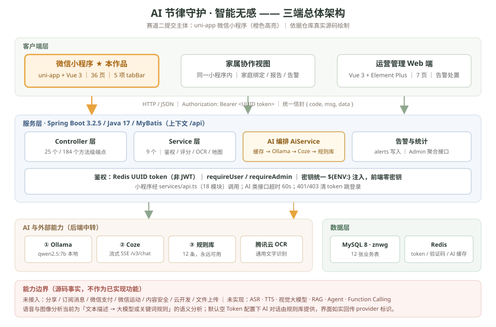

# 赛道二 · 作品说明文档（a–g 七项 · 源码校正定稿）

> 作品名称：**AI 节律守护 · 智能无感**
> 第九届传智杯全国大学生数智创新与 AI 应用大赛 · 赛道二「AI 微信小程序开发」
> 版本：v2.0 ｜ 编制日期：2026-11-15
>
> **本版相对草稿的变更**：全部功能描述、数字、代码片段已按仓库实际源码复核，修正了「JWT 鉴权」「153 接口」「微信一键登录/分享/订阅消息/文件上传已接入」「ASR/TTS/视觉模型/跌倒检测已实现」「测试记录预填通过」等与源码不符的表述；补齐 c.5 商业模式创新、d.1 架构图、d.4 真实代码片段、b 项能力清单；无法由源码产生的截图、录屏、真机测试记录保留为**待人工执行项**，不填虚假结论。
> 逐条对照见同目录《02-源码事实校正说明.md》。

---

## 提交格式提醒

| 项 | 要求 |
|---|---|
| 附件格式 | **仅接受 ZIP** |
| 大小 | **建议 ≤ 300MB** |
| 命名 | `第九届传智杯-AI小程序赛道-<作品名称>` |
| 建议包含 | 源代码、演示视频、作品说明文档、体验说明 / 测试账号 / 体验二维码截图 |

---

# a. 项目说明

## a.1 项目背景

我国正快速进入深度老龄化社会，独居老人的日常安全与健康监护成为突出社会问题：子女异地工作难以 24 小时陪伴；突发状况（跌倒、突发疾病）难以及时发现；老年人对复杂 App 接受度低；传统智能硬件价格与安装门槛高。

**本项目定位**：以微信小程序为轻量载体，用 AI 辅助分析 + 结构化数据 + 家属协作，为独居老人提供**低门槛、可负担**的健康守护，并通过运营管理 Web 端形成告警处置闭环。

## a.2 目标用户

| 用户角色 | 画像 | 核心诉求 |
|---|---|---|
| 主用户：独居/空巢老人 | 60 岁以上，手机使用能力有限 | 操作简单、大字号、一键求助 |
| 协作用户：子女/家属 | 30–50 岁，异地工作 | 远程查看长辈状态、接收告警 |
| 管理用户：服务机构 | 社区/养老机构工作人员 | 批量管理、告警处理（Web 管理端） |

## a.3 使用场景（按已实现功能描述）

| 场景 | 已实现的支撑功能 |
|---|---|
| 日常节律 | 作息打卡、健康评分、周历、今日活动（`pages/home`、`checkinApi`） |
| 紧急求助 | 长按 3 秒 SOS 触发告警、位置上报、紧急联系人拨号（`pages/sos-map`、`guardianApi`） |
| 异常告警 | 文本/描述类健康分析写入 `alerts` 表；告警历史与处置（`MonitorController`、`AdminController`） |
| AI 陪伴 | 文字对话「小护」，三层降级保证任何情况下有回复（`pages/ai-chat`、`AiService`） |
| 用药与记录 | 用药提醒、服药记录、饮食记录、运动记录（对应 4 组页面与 Controller） |
| 家属远程守护 | 家庭成员绑定、健康报告、告警历史、位置详情（`familyApi`、`locationApi`） |

> **边界说明**：语音监测页面会真实录音，但当前版本**丢弃音频、传固定模板文字**给后端；图像监测页面只本地选图、传「画面描述」，**未接入视觉模型**。因此「跌倒自动识别」「语音转写」不属于本版本已实现能力，详见 b.3.3 与 d.6。

## a.4 核心功能清单（按 `pages.json` 实测 36 页分组）

| # | 模块 | 页面数 | 代表页面 |
|---|---|---|---|
| 1 | tabBar 主入口 | 5 | 节律守护、居家守护、健康监测、智能助手、个人中心 |
| 2 | 认证 | 3 | 登录、注册、找回密码 |
| 3 | 报告与分析 | 4 | 守护面板、健康报告、健康详情、睡眠分析 |
| 4 | 家庭 | 3 | 家庭成员、成员绑定、长辈档案 |
| 5 | 记录 | 4 | 用药提醒、服药记录、饮食记录、运动记录 |
| 6 | 安全 | 4 | 紧急求助、告警历史、紧急联系人、位置详情 |
| 7 | 设备与监测 | 5 | 我的设备、蓝牙连接、监测历史、语音监测、视频监测 |
| 8 | 设置与协议 | 8 | 设置、长辈极简模式、隐私安全、关于我们、用户协议、隐私政策、声纹授权协议、调试日志 |

> 合计 **36 个页面**，与 `src/pages/` 下 36 个 `index.vue` 一一对应。

## a.5 核心流程（源码实际链路）

```
【老人主流程】
打开小程序 → 登录（手机号验证码 / 微信登录视配置而定）
    ↓
首页「节律守护」→ 今日打卡 → 健康评分 → 建议
    ↓
【异常时】长按 SOS 3 秒
    ↓
POST /api/guardian/sos → 写 alerts 表 → 查询绑定的紧急联系人
    ↓
返回「已通知 N 位家属」文案（notified = 联系人数）
    ↓
【家属 / 机构】
小程序查看告警历史与位置 → 电话联系（uni.makePhoneCall）
Web 管理端「告警处置」→ 填写处理说明 → 状态闭环

【AI 对话流程】
用户提问 → aiApi.chat → 后端 AiService
    ↓
Redis 缓存命中 → provider=cache
    ↓ 未命中
① Ollama（默认关闭）→ ② Coze（默认 Token 为空）→ ③ 12 条规则库
    ↓
返回回复 + provider 标识（用户永远拿到结果，不显示技术错误）
```

> **如实说明**：`GuardianController` 的 SOS 接口当前只写告警表并查询联系人列表，**没有短信、电话或订阅消息的真实推送**；文案中的「已通知」是返回值描述，不是已送达的凭证。这一项已列入后续迭代，不作为已实现能力计分。

## a.6 演示录屏片段

**状态：待人工录制**（WorkBuddy 无法代录）。规格如下，脚本见仓库《06-演示视频脚本.md》：

| 片段 | 时长 | 内容 |
|---|---|---|
| S1 | 30–60 秒 | 打卡 → 健康评分 → 今日建议 |
| S2 | 30–45 秒 | 长按 3 秒 SOS → 告警生成 → 告警历史 |
| S3 | 40–60 秒 | AI 对话正常回复 → 关闭外部模型 → 规则库降级回复（展示 `provider`） |

要求：1080p、无真实密钥入镜、与本文档能力边界表述一致。录制后嵌入 PDF 或作为 ZIP 内附件。

---

# b. 小程序与 AI 能力说明

> 对应赛题要求：明确标注调用的微信能力、云开发能力与 AI 能力。以下按源码逐项核查，**未找到调用代码的绝不标为已接入**。

## b.1 微信小程序能力调用清单

| 能力 | 源码依据 | 真实状态 |
|---|---|---|
| 手机号验证码登录 | `pages/login/index.vue` + `POST /api/auth/login` | ✅ 已实现 |
| 微信登录 `uni.login()` | `pages/login/index.vue` 第 298 行调用；后端 `WeChatService.code2Session` | ⚠️ 前端已调用，但**未配置 AppID/Secret 时后端返回 `available=false`** |
| 地理位置 `uni.getLocation()` | `pages/sos-map/index.vue` 第 238 行、`pages/location-detail/index.vue` 第 239/265 行 | ✅ 已实现 |
| 录音 `uni.getRecorderManager()` | `pages/voice-monitor/index.vue` 第 197 行 | ⚠️ 已调用，但音频被丢弃，未做转写 |
| 拍照/选图 `uni.chooseImage()` | `pages/video-monitor/index.vue` 第 121 行 | ⚠️ 已调用，但只本地展示，未上传 |
| 蓝牙 BLE | `pages/bluetooth-connection/index.vue` 第 144/166/248 行 | ✅ 已实现 |
| 拨打电话 `uni.makePhoneCall()` | `pages/about`、`emergency-contacts`、`sos-map`、`guardian-panel` | ✅ 已实现 |
| 权限设置 `getSetting/openSetting` | `pages/privacy-security/index.vue` 第 179/201 行 | ✅ 已实现 |
| 剪贴板 / 系统信息 / Toast | `pages/about/index.vue` 等 | ✅ 已实现 |
| 分享转发 `onShareAppMessage` | 全库未找到调用 | ❌ 未接入 |
| 订阅消息 `requestSubscribeMessage` | 仅 `application.yml` 有模板配置项，无发送代码 | ❌ 未接入 |
| 微信支付 `requestPayment` | 仅 README 列为 P3 待办 | ❌ 未接入 |
| 微信运动 `wx.getWeRunData` | 前端未调用；后端 `WeRunController` 只返回「请前端自行解密」指引 | ❌ 未接入 |
| `chooseLocation` | 仅 `manifest.json` 声明，未调用 | ❌ 未接入 |
| 内容安全接口 | 全库未找到调用 | ❌ 未接入 |
| 文件上传 `uploadFile` | 前端未找到调用（历史文档描述的是原 Taro 项目） | ❌ 未接入 |

`manifest.json` 中声明的权限：`scope.userLocation`、`scope.record`、`scope.camera`、`scope.writePhotosAlbum`，以及 `requiredPrivateInfos: ["getLocation","chooseLocation"]`。

> 📌 **如实申报的好处**：赛题 b 项要求「明确标注」，把已调用与未接入分开列，比堆砌 ✅ 更可信；「未接入」项可在 g 项落地规划中对应到具体版本。

## b.2 微信云开发能力

本项目**未使用微信云开发**（全库无 `wx.cloud` / `uniCloud` / 云函数目录），采用自建后端 Spring Boot 3.2.5 + MySQL 8 + Redis。

| 考虑 | 说明 |
|---|---|
| AI 链路时长 | AI 调用需缓存 → Ollama → Coze → 规则库的长链路编排与超时控制 |
| 接口规模 | 后端 25 个 Controller / 184 个方法级端点，单函数模型不合适 |
| 数据复杂度 | 12 张表 + 多维统计聚合，需要 MySQL 索引与事务 |
| SDK 依赖 | 腾讯云 OCR / 短信 SDK、HttpClient5 等 Java 依赖 |
| 运维可控 | Redis 缓存、连接池、降级日志需精细排查 |

这是基于业务特点的**主动架构选择**，不是能力限制。

## b.3 AI 能力清单（重点）

### b.3.1 三层降级架构（真实实现）

`guardian-server/src/main/java/com/guardian/ai/AiService.java` 第 90–151 行：

```
Redis 缓存（命中 → provider=cache）
      ↓ 未命中
① Ollama 本地模型 qwen2.5:7b（默认 enabled=false）
      ↓ 失败 / 超时
② Coze 云端智能体（流式 SSE /v3/chat，需 COZE_API_TOKEN + COZE_BOT_ID）
      ↓ 未配置 / 失败 / 4100 认证失败
③ 本地规则库 12 条关键词规则（永远可用）
      ↓
ChatResult（含 provider = ollama | coze | rule | cache）
```

**设计价值**：任何一层失败自动降级，用户不会看到报错。对老年用户产品，这是刚性要求。

> ⚠️ **默认配置提醒**：`ollama.enabled` 默认 `false`，Coze Token / Bot ID 默认为空，`AiService.chat()` 会跳过前两层，**实际由规则库提供回复**。演示前需注入 Coze Token 或启动 Ollama，界面会如实显示 `provider=rule`。

### b.3.2 AI 能力矩阵（按源码真实实现）

| AI 能力 | 接口 | 真实技术实现 | 状态 |
|---|---|---|---|
| 对话问答 | `POST /api/ai/chat` | 三层降级 + 健康上下文注入 | ✅ 已实现 |
| 增强对话 | `POST /api/ai/chat/enhanced` | 规则前置 + LLM | ✅ 已实现 |
| 综合分析 | `POST /api/ai/analyze` | 调用 `AiService.chat` | ✅ 已实现 |
| 睡眠分析 | `POST /api/ai/sleep-analysis` | 时序数据 + LLM/规则 | ✅ 已实现 |
| 健康日报 / 周报 | `GET /api/ai/report/daily`、`/weekly` | 数据聚合 + 生成 | ✅ 已实现 |
| 文本健康分析 | `POST /api/monitor/text-analyze` | 文本 → LLM/规则 | ✅ 已实现 |
| **语音分析** | `POST /api/monitor/voice-analyze` | **固定模板文字** → LLM/规则；**无 ASR** | ⚠️ 占位链路 |
| **图像 / 帧分析** | `POST /api/monitor/image-analyze`、`/analyze-frame` | **画面描述文字 / base64 长度摘要** → LLM/关键词；**无视觉模型** | ⚠️ 语义分析 |
| **跌倒检测** | `POST /api/monitor/fall-detect` | 描述文本命中 `FALL_KEYWORDS`，或让 LLM 回答「有/无风险」；**无姿态/CV 模型** | ⚠️ 关键词判定 |
| 腾讯云通用 OCR | `ImageRecognizeService` | `GeneralBasicOCR` 真实 SDK 调用；未配置密钥返回 `provider=unconfigured` | ✅ 已实现（需密钥） |
| OCR + AI 串联解释 | `ImageRecognizeService` 第 147–189 行 | 先 OCR 抽字，再交 `AiService.chat` 解释 | ✅ 已实现 |
| 腾讯位置服务 | `TencentMapService` | 逆地理 / 地理编码 / POI 周边真实 HTTP | ✅ 已实现（需密钥） |
| 健康评分 | `HealthScoreService` | 五项加权规则算法（睡眠 30 / 用药 25 / 运动 20 / 饮食 15 / 监测 10） | ✅ 规则算法，非 ML |
| 语音合成 TTS | `POST /api/ai/tts` | 返回 `available=false` | ❌ 占位 |
| 真实天气 | `WeatherController` | 响应带 `mock:true` | ❌ 模拟值 |

**未实现（明确不计入交付功能）**：RAG / 向量检索、Agent 工作流、Function Calling / MCP、视觉大模型、ASR 语音转写、声纹识别、视频流实时分析。

### b.3.3 语音与图像链路的真实数据流（避免误判）

- `pages/voice-monitor/index.vue`：录音 `onStop` 回调为空（注释「不保存音频」），松开后调用固定文本「（语音片段 N 秒）老人主诉身体不适，请结合近期作息与用药给出建议。」送 `monitorApi.voiceAnalyze(text)`；接口失败时用本地固定文案兜底（`provider='本地规则'`）。
- `pages/video-monitor/index.vue`：`uni.chooseImage` 只把临时路径存入本地展示，H5/取消时用演示图占位；随后用「描述文字」调 `monitorApi.imageAnalyze(desc)`，**不上传图片**。
- `MonitorController` 第 48–50、124–126 行注释明确「没有视觉模型接入」「不做真实二进制解码」。

> 这两条链路体现的是「**文本描述的健康语义分析**」，不是多模态理解。文档中保留此说明，是为了让评审看到团队对能力边界的清醒认知。

### b.3.4 规则库设计（第三层兜底）

12 条关键词规则，覆盖老年用户最常问的话题：问候、健康、步数、睡眠、用药、情绪、饮食、位置、SOS、家人、感谢、告别。关键词刻意收窄（例如「健康/身体」不含「怎么样」），避免泛词抢占导致「我今天睡眠怎么样」走不到睡眠规则。`LocalRuleProvider.reply()` 对单条规则也做了异常隔离，保证兜底永远可用。

### b.3.5 AI 安全设计

| 设计 | 说明 |
|---|---|
| 密钥不下发前端 | 所有 AI 调用经后端中转，Token 存环境变量；前端零密钥 |
| 降级不报错 | 三层兜底，用户永远拿到回复 |
| 不假装成功 | 接口失败时展示明确提示，不伪造 AI 回复（`pages/ai-chat`） |
| 不替代医疗诊断 | AI 回复用于建议与陪伴，不作为诊断结论 |
| 配额保护 | OCR 每人每日 20 次 / 全局 500 次 Redis 配额 |
| 仓库无明文密钥 | `application.yml` 全 `${ENV:}` 占位、`.env.example` 空值、`.gitignore` 排除 `.env` |

---

# c. 创新点说明（六维度）

## c.1 AI 应用创新：**面向「永不失效」的降级式 AI 守护**

传统 AI 应用把大模型当唯一依赖，服务抖动即功能失效。本项目以「老年用户无法理解技术错误」为设计约束，构建 缓存 → Ollama → Coze → 规则库 的四级响应链，并把 `provider` 回传到界面。系统在**零 Token、断网、模型超时**条件下仍给出确定性回复，同时把 API 成本压到最低。

本版本不宣称「三模态视觉理解 + 跌倒自动识别」；创新点落在**可用性架构**与**成本结构**上，这是源码能支撑的真实创新。

## c.2 场景创新：「老人 — 家属 — 机构」三级守护闭环

多数适老化产品只服务一方。本项目通过家庭绑定把老人端与家属端连起来，再由 Vue 管理端承接机构侧的告警处置：老人只需打卡 + 长按 SOS，家属远程查看，机构批量跟进并留下处理记录。**告警有终点，不是一条被忽略的推送。**

## c.3 产品创新：同一数据模型上的双信息架构

| 老人端（小程序） | 机构端（Web 管理端） |
|---|---|
| 大字号、少层级、语音优先入口 | 侧边导航、多栏布局、筛选表格 |
| 5 个 tabBar 主入口 | 7 个功能页 + ECharts 趋势 |

两端共用 Spring Boot 后端与 12 张表，通过 `src/api/index.ts` 字段适配层与 `src/services/request.ts` 统一信封各自适配，避免为不同角色重复建设数据链路。

## c.4 技术创新：密钥后端中转 + 可观测降级

原 Taro 版本存在 5 类密钥泄露（前端硬编码 Coze Token、地图 Key 等）。重构后所有第三方调用后移到 Spring Boot，配置统一 `${ENV:}` 占位，前端与仓库零密钥。配合 `provider` 标识、缓存键与降级日志，形成「安全 + 可观测」双重工程改进。这一改动既是安全整改，也是架构正确性的证明。

## c.5 商业模式创新：**基础守护永久免费 + 由子女付费的增强层**

> 本项在草稿中为「待填」，现依据 g 项第五节定稿补齐。

传统老年健康产品向老人收费，转化困难。本项目的付费决策者是**子女**而非老人：

- **基础层永久免费**：打卡、SOS、告警、基础 AI 对话 —— 保证守护不因付费门槛中断，也符合老年用户付费习惯。
- **增强层订阅**：家属端多长辈管理、健康报告导出、AI 深度分析（9.9–29.9 元/月）。
- **B 端机构服务**：社区/养老机构批量部署（500–5000 元/月/机构），由机构采购、老人免费使用。
- **成本侧天然可控**：Ollama 本地模型优先 → Coze 云端兜底 → 规则库零成本运行。多数 AI 应用「用户越多亏越多」，而三层降级实现了**低成本优先**的成本结构。
- **两阶段主体路线**：参赛期以个人主体验证价值（无支付能力），2027 Q2 迁移企业主体后开通支付与认证。

> 单位经济模型数值为**估算**（单家庭 1–3 元/月成本、高级版毛利率 70–90%），暂无真实 API 用量实测数据，不作为实测结论。

## c.6 用户体验创新：适老化的系统性落地

| 设计点 | 真实落地情况 |
|---|---|
| 大字号 / 极简模式 | `pages/simple-mode` 长辈极简模式；原项目「有 CSS 未挂载」的缺陷已修正 |
| 长按 SOS 3 秒 | 与文案一致（原项目代码实际 1 秒，已修正） |
| 错误友好 | 任何 AI 失败都降级，不显示技术错误 |
| 真实数据 | 原项目首页睡眠评分为硬编码假数据，现改为 `HealthScoreService` 真实计算 |
| 协议与隐私 | 用户协议、隐私政策、隐私安全设置、声纹授权协议页齐备 |

> 原草稿把「TTS 语音播报」列为体验创新，实际 `/ai/tts` 返回 `available=false`，本版已移除该表述，改列为后续迭代。

---

# d. 技术实现

## d.1 系统架构图



<div style="font-size:0.85em;color:#666">图 d-1　三端总体架构。小程序端为本赛道提交主体，AI 推理集中在后端，Web 管理端承接告警处置。</div>

架构分层：

| 层 | 技术 | 关键事实 |
|---|---|---|
| 小程序表现层 | uni-app 3.0 + Vue 3.4 + TypeScript 5.4 + Pinia 2.1 | 36 页 / 19,976 行；5 项 tabBar；`dev:mp-weixin` / `build:mp-weixin` / H5 脚本 |
| 请求层 | `src/services/request.ts` | `uni.request` 封装、Bearer 注入、统一信封、AI 接口 60s 超时、401/403 跳登录 |
| 接口层 | `src/services/api.ts` | 18 个 API 模块、117 处 `/api/` 路径 |
| 服务层 | Spring Boot 3.2.5 / Java 17 / MyBatis 3.0.3 | 25 个 Controller、184 个方法级端点、9 个 Service、11 个 Mapper |
| AI 层 | `ai/AiService.java` + `ai/LocalRuleProvider.java` | 三层降级、12 条规则、Redis 缓存 300s、上下文注入 |
| 数据层 | MySQL 8（`znwg`，12 表）+ Redis | 验证码、token、AI 缓存、OCR 配额 |

## d.2 页面结构（`src/pages.json` 实测）

```
tabBar（5）  节律守护 / 居家守护 / 健康监测 / 智能助手 / 个人中心
认证（3）    login、register、forgot-password
报告（4）    guardian-panel、health-report、health-detail、ai-sleep-analysis
家庭（3）    family、member-bind、elder-info
记录（4）    medicine-reminder、medication-history、diet-record、exercise-record
安全（4）    sos-map、alert-history、emergency-contacts、location-detail
设备监测（5）device、bluetooth-connection、monitor-history、voice-monitor、video-monitor
设置协议（8）settings、simple-mode、privacy-security、about、
            user-agreement、privacy-policy、voiceprint-agreement、debug-log
```

tabBar 选中色 `#8FA68E`、未选中 `#7D746B`、背景 `#FFF9EF`。

## d.3 前后端协同方式

| 项 | 真实实现 |
|---|---|
| 通信协议 | HTTP + JSON（开发期 `urlCheck:false`） |
| **鉴权** | **Redis 随机 UUID token**（7 天有效），`Authorization: Bearer`；**不是 JWT**，源码无 JWT 使用代码 |
| 后端校验 | 每个 Controller 手动 `authService.requireUser(token)`，管理员接口 `requireAdmin` |
| 接口封装 | `src/services/request.ts` 统一拦截、Token 注入、错误码处理 |
| 接口定义 | `src/services/api.ts`（18 模块 / 117 处 `/api/` 路径） |
| 状态管理 | Pinia |
| 响应格式 | `{ code, msg, data }`（HTTP 恒 200，成功判定 `code===200`） |
| 契约文档 | `docs/API契约.md` 声明 130 个接口（提取自原 NestJS 项目），当前 Java 实现 184 个方法级端点 |

> ⚠️ `src/services/request.ts` 第 30 行硬编码 `DEV_LAN_IP = '10.224.107.234'`，真机预览需手动改为后端局域网 IP；`manifest.json` 的 `mp-weixin.appid` 为硬编码值。两项均列入提交前清理清单。

## d.4 关键代码片段（真实源码，非伪代码）

### 片段 1　三层降级主入口 —— `ai/AiService.java` 第 113–151 行

```java
// ---------- ① Ollama ----------
if (ollamaEnabled) {
    try {
        String reply = callOllama(text, ctx);
        if (StrUtil.isNotBlank(reply)) {
            cache(cacheKey, reply);
            return ChatResult.of(reply, conversationId, "ollama", start);
        }
    } catch (Exception e) {
        log.warn("[AI] Ollama 失败，降级到 Coze: {}", e.getMessage());
    }
}
// ---------- ② Coze ----------
if (cozeEnabled && StrUtil.isNotBlank(cozeToken) && StrUtil.isNotBlank(cozeBotId)) {
    try {
        String reply = callCoze(text, conversationId, ctx);
        if (StrUtil.isNotBlank(reply)) {
            cache(cacheKey, reply);
            return ChatResult.of(reply, conversationId, "coze", start);
        }
    } catch (Exception e) {
        log.warn("[AI] Coze 失败，降级到规则库: {}", e.getMessage());
    }
}
// ---------- ③ 规则库兜底 ----------
String reply = ruleProvider.reply(text, ctx == null ? AiContext.empty() : ctx);
cache(cacheKey, reply);
return ChatResult.of(reply, conversationId, "rule", start);
```

### 片段 2　Coze 流式调用与密钥中转 —— 同文件第 202–222 行

```java
JSONObject body = new JSONObject();
body.set("bot_id", cozeBotId);
body.set("user_id", "guardian-user");
body.set("stream", true);
body.set("auto_save_history", true);
body.set("additional_messages", new Object[]{
        Map.of("role", "user", "content", buildPrompt(message, ctx), "content_type", "text")
});
HttpRequest chatReq = HttpRequest.newBuilder()
        .uri(URI.create(cozeBaseUrl + "/v3/chat"))
        .timeout(Duration.ofSeconds(cozeTimeout))
        .header("Authorization", "Bearer " + cozeToken)
        .header("Content-Type", "application/json")
        .header("Accept", "text/event-stream")
        .POST(HttpRequest.BodyPublishers.ofString(body.toString(), StandardCharsets.UTF_8))
        .build();
```

### 片段 3　能力边界自述 —— `controller/MonitorController.java` 第 118–151 行

```java
/**
 * 图像 / 视频帧分析
 * ★ 真正的图像识别不在本服务做（没有视觉模型接入），
 *   接口接收「画面描述」文本，据此判断风险并给出建议。
 */
@PostMapping("/analyze-frame")
public ApiResponse<Map<String, Object>> analyzeFrame(HttpServletRequest req,
                                                     @RequestBody Map<String, Object> body) {
    User user = authService.requireUser(token(req));
    String description = ViewUtil.toStr(body == null ? null : body.get("description"));
    String imageBase64 = ViewUtil.toStr(body == null ? null : body.get("imageBase64"));
    if (description == null && imageBase64 == null) {
        throw BizException.badRequest("请提供画面描述（description）或图像数据（imageBase64）");
    }
    ...
}
```

### 片段 4　腾讯云 OCR 真实调用 —— `service/ImageRecognizeService.java` 第 289–312 行

```java
private List<String> callOcrBase64(OcrClient c, String base64) {
    List<String> lines = new ArrayList<>();
    try {
        GeneralBasicOCRRequest req = new GeneralBasicOCRRequest();
        req.setImageBase64(base64);
        GeneralBasicOCRResponse resp = c.GeneralBasicOCR(req);
        TextDetection[] detections = resp.getTextDetections();
        if (detections != null) {
            for (TextDetection d : detections) {
                if (StrUtil.isNotBlank(d.getDetectedText())) {
                    lines.add(d.getDetectedText().trim());
                }
            }
        }
    } catch (Exception e) {
        log.warn("[识图] OCR 调用失败（返回空）: {}", e.getMessage());
    }
    return lines;
}
```

### 片段 5　前端「不假装成功」 —— `pages/ai-chat/index.vue` 第 240–261 行

```ts
const res = await aiApi.chat(content, conversationId.value)
conversationId.value = res?.conversationId || conversationId.value
const reply = res?.content
if (reply) {
  messages.value.push({ id: 'a-' + Date.now(), role: 'assistant',
    content: reply, timestamp: Date.now(), provider: res?.provider })
} else {
  // 后端返回成功但没有内容 —— 给个明确提示而不是假装有回复
  messages.value.push({ id: 'a-' + Date.now(), role: 'assistant',
    content: '抱歉，我没能理解你的意思，能再说一次吗？', timestamp: Date.now() })
}
```

## d.5 AI 接入方案

见 **b.3 AI 能力清单**；配置位于 `application.yml` 第 70–104 行，密钥模板见 `.env.example`。

## d.6 难点与解决方案（按源码校正）

| # | 难点 | 真实解决方案 |
|---|---|---|
| 1 | 外部 AI 服务不可靠 | 三层降级 + Redis 缓存 + `provider` 可观测，用户无感知 |
| 2 | 密钥泄露风险 | 全部 AI / 云调用后端中转，环境变量注入，前端零密钥 |
| 3 | 规则库误匹配 | 关键词刻意收窄，避免泛词抢占；单条规则异常隔离 |
| 4 | 前后端字段命名差异 | Web 端 `api/index.ts` 字段适配层；小程序端 `services/request.ts` 统一信封 |
| 5 | uni-app 编译重置 `urlCheck` | `vite.config.ts` 自定义插件在 `closeBundle` 写回 |
| 6 | 真机预览后端地址 | 当前硬编码 `DEV_LAN_IP`，**待改为环境变量** |
| 7 | 语音/图像二进制链路未打通 | 当前以文本描述走语义分析；ASR / 视觉模型列入 v1.1 迭代 |
| 8 | 统计口径不一致导致负数 | 统一口径 + 边界保护（`转换决策记录`） |

---

# e. 成果展示

## e.1 功能界面截图

**状态：待人工截取**（15–20 张）。规格见仓库《05-截图与测试记录规格.md》，建议清单：

| 模块 | 截图 |
|---|---|
| 登录 | 验证码登录页、微信登录（若已配置） |
| 节律守护 | 首页打卡、健康评分、周历 |
| 居家守护 | SOS 长按界面、告警列表 |
| 健康监测 | 语音监测、图像监测（**标注为文本语义分析**）、监测历史 |
| 智能助手 | AI 对话正常回复、AI 对话降级规则回复（`provider=rule`） |
| 个人中心 | 健康报告、用药提醒、家庭成员 |
| 后台管理 | Dashboard、告警处理页 |

> 截图不得展示未实现能力，也不要把 `demo://fallback` 占位图当作真实识别结果。

## e.2 关键流程演示

**状态：待人工录制**，三段：① 打卡 → 健康评分；② 长按 3 秒 SOS → 告警生成；③ AI 对话 → 关闭外部模型后展示规则库降级。

## e.3 运行效果说明（源码实测口径）

| 指标 | 数值 | 说明 |
|---|---|---|
| 小程序页面 | 36 个 / 19,976 行 | `src/pages/` 实测 |
| Web 管理端视图 | 7 个 / 1,169 行 | `src/views/` 实测 |
| 后端 Java 文件 | 67 个 / 17,565 行 | `find src -name "*.java"` |
| Controller / 方法级端点 | 25 / 184 | 注解统计 |
| 数据库表 | 12 张 | `V1__init_schema.sql` |
| 本地规则库 | 12 条 | `LocalRuleProvider` |
| 健康评分权重 | 30/25/20/15/10 | `HealthScoreService` |

> 历史文档中的「153 接口」「14,732 行」「9 个视图」「60 个 Java 文件」为旧口径，本版统一采用实测值。

## e.4 测试记录

> ⚠️ **本表为待执行用例，不是已完成的测试报告。** 草稿中预填的「同预期 / ✅」已被清除——赛题要求「必要的测试记录」，**如实记录比虚假全过更可信**。团队在真机执行后填写「实际结果」与「结论」再提交。

### 功能测试（12 项）

| # | 测试项 | 步骤 | 预期 | 实际结果 | 结论 |
|---|---|---|---|---|---|
| 1 | 验证码登录 | 输入手机号 → 获取验证码（后端日志）→ 登录 | 进入首页 | 待执行 | — |
| 2 | 微信登录 | 配置 AppID/Secret 后点击一键登录 | 登录成功；未配置时提示不可用 | 待执行 | — |
| 3 | 作息打卡 | 首页点击打卡 | 记录成功、健康评分更新 | 待执行 | — |
| 4 | 长按 SOS 3 秒 | 长按触发 | 写入告警、返回联系人列表 | 待执行 | — |
| 5 | 告警处置闭环 | Web 端筛选待处理 → 填写说明提交 | 状态更新并可复查 | 待执行 | — |
| 6 | AI 对话（外部模型可用） | 配置 Coze 后问「今天睡眠怎么样」 | 返回带上下文的回复 | 待执行 | — |
| 7 | AI 对话（降级） | 清空 Coze Token / 关闭 Ollama 后提问 | 规则库回复、`provider=rule`、不报错 | 待执行 | — |
| 8 | 语音监测链路 | 录音后松开 | 返回文本语义分析结果（**非语音转写**） | 待执行 | — |
| 9 | 图像监测链路 | 选图后提交 | 返回描述文字分析结果（**非视觉识别**） | 待执行 | — |
| 10 | 家庭成员绑定 | 生成邀请码 → 家属绑定 | 绑定成功、双方可见 | 待执行 | — |
| 11 | 用药提醒 | 设置提醒 → 到点查看 | 提醒产生、可记录服药 | 待执行 | — |
| 12 | 密钥检查 | 检索前端包与仓库 `pat_` / `sk-` / `AKIA` | 无真实密钥 | 待执行 | — |

### 兼容性与构建

| 项 | 环境 | 预期 | 实际结果 |
|---|---|---|---|
| 微信开发者工具 | 最新稳定版 | `build:mp-weixin` 通过 | 待执行 |
| iOS 真机 | 【待填系统/微信版本】 | 主要流程可用 | 待执行 |
| Android 真机 | 【待填系统/微信版本】 | 主要流程可用 | 待执行 |
| 后端构建 | JDK 17 + Maven | `mvn compile` 通过 | 待执行 |
| Web 端构建 | Node ≥20 | `npm run build` 通过 | 待执行 |

> 注意：本仓库副本不含 `node_modules` / `target`，需先 `npm ci` 与 `mvn compile`；`start.bat` 内 JDK/MySQL/Redis 为开发机绝对路径，换机器需修改。

---

# f. 历史说明

> 依据《03-历史说明-f项定稿.md》，并按源码事实校正数字与能力表述。

**本项目存在技术迭代历史，非往届参赛作品。**

## 一、迭代概况

前身为 `ai-rhythm-guardian v3.0.0`（Taro + React 技术栈），经完整重构为当前版本（uni-app + Vue 3 + Spring Boot）。重构过程留存了完整的技术分析与决策记录，可追溯、可验证。

| 项 | 原版本 v3.0.0 | 当前版本 |
|---|---|---|
| 项目名 | ai-rhythm-guardian | AI 节律守护 · 智能无感 |
| 前端 | Taro 4.1.9 + React 18 + Tailwind 4 + Zustand | uni-app 3.0 + Vue 3 + TypeScript + Pinia |
| 后端 | NestJS + Supabase（PostgreSQL） | Spring Boot 3.2.5 + MyBatis + MySQL 8 + Redis |
| 页面数 | 36 | 36 |
| 接口 | 契约 136（原 NestJS）；现有文档曾写 153 | **Java 实测 184 个方法级端点** |
| 发布状态 | 未发布（游客模式调试） | 见「五、发布计划」 |

## 二、相对原版本的优化部分

### 2.1 安全问题修复（最重要）

| # | 原问题 | 修正 |
|---|---|---|
| 1 | Coze Token 硬编码在前端（`coze.config.ts`、`ai-chat/index.tsx`），可反编译提取 | 所有 AI 调用后移到后端，Token 存环境变量，前端零密钥 |
| 2 | 地图 Key 硬编码在前端 | 同上，改为后端中转 |
| 3 | 密钥同时存在于 `server/.env` | 统一 `.env` 管理 + `.gitignore` 排除 |
| 4 | `application.yml` 中密钥作为默认值 | 改为空默认值，强制环境变量注入 |
| 5 | 文档中记录了泄露密钥原文 | 全部脱敏处理 |

> 《安全审计报告》随项目提交，记录了 5 类泄露点的位置、风险等级与处理方式。该报告审计对象是**原项目**，不是当前源码。

### 2.2 功能缺陷修复（14 处）

原项目存在「跌倒检测 SOS 弹窗写在条件块外」「首页睡眠评分硬编码假数据」「大字模式 CSS 未挂载」「SOS 文案 3 秒但代码 1 秒」「设备/老人状态死值」「配色不统一」「电话号码硬编码」「catch 用闭包旧值」「统计口径不一致导致负数」「healthScore 恒为 null」「账号注销仅 toast」「设置项不持久化」「5 处密钥泄露」「userId 写死」共 14 处缺陷，本次重构逐条修正。完整决策记录见 `docs/转换决策记录.md`。

### 2.3 AI 能力升级

| 能力 | 原版本 | 当前版本 |
|---|---|---|
| 降级机制 | 单层（Coze 失败即报错） | 缓存 → Ollama → Coze → 12 条规则库 |
| 规则库 | 无独立实现 | 独立 `LocalRuleProvider`，永远可用 |
| 健康上下文 | 无 | 评分/步数/睡眠/服药/位置注入 prompt |
| 可观测性 | 无 | `ChatResult.provider` 回传来源 |
| 健康报告 | 无 | 日报 / 周报生成 |

> **校正说明**：原 f 项写「语音/图像/文本三模态 + 跌倒检测 + 视频帧分析」「TTS 播报」为当前版本新增能力，与源码不符——当前语音/图像为文本描述语义分析、无视觉模型、TTS 为占位。本版已删除该表述，改列入 g 项 v1.1 迭代计划。

### 2.4 架构升级

前后端分离并明确 RESTful 契约；`start.bat` 提供一键检查/建库/编译/启动；新增 Vue 3 独立管理端（**7 个视图**，原文档写 6 个已校正）；数据层由 PostgreSQL 迁移至 MySQL（12 张表）。

### 2.5 适老化落地

大字号模式真正挂载并可开关、长按 3 秒 SOS 与文案一致、长辈极简模式页面、错误友好降级。TTS 播报为占位，不计入本版落地项。

## 三、关于参赛主体

- **当前主体**：个人主体（微信小程序）
- **规划主体**：后续升级为企业主体以支持微信支付等商业能力
- 本次参赛以现有个人主体作品形态提交；个人主体无法开通微信支付，本版本不含支付功能

## 四、原创性声明

本作品为团队独立开发，前后端代码由团队成员编写（借助 AI 辅助编程工具，均经团队成员理解与验证）；未抄袭任何开源项目，未直接套用他人成果；原版本 `ai-rhythm-guardian v3.0.0` 亦为本团队自有作品。

> ⚠️ **需团队确认后提交**：① 本作品是否曾在往届或其他比赛投递（若无，当前「非往届参赛作品」表述成立）；② 原版本是否为团队自有作品。这两项文档原始草稿已标注需人工确认，请勿未经核实直接提交。

技术迭代过程留存记录：`docs/转换决策记录.md`、`docs/安全审计报告.md`、`docs/VTJ转换方案.md`、`docs/页面分析-前5页.md` / `页面分析-后7页.md`。

## 五、发布计划

| 阶段 | 时间 | 状态 |
|---|---|---|
| 个人主体体验版 | 参赛期间 | 计划提交审核（未完成） |
| 企业主体迁移 | 参赛后 | 已规划 |
| 正式上线 | 2027 Q1 | 规划中 |

---

# g. 落地规划

> 依据《04-落地规划-g项定稿.md》，并按源码事实校正「分享能力已接入」等表述。

## 一、主体与合规路线

采取「**个人主体验证 → 企业主体商用**」两阶段路线：

| 阶段 | 主体 | 时间 | 目标 | 商业能力 |
|---|---|---|---|---|
| 第一阶段 | 个人主体 | 参赛期 – 2027 Q1 | 验证产品价值、积累真实用户 | 分享传播（**待接入**）；无支付 |
| 第二阶段 | 企业主体 | 2027 Q2 起 | 商业化运营、接入硬件、拓展 B 端 | 支付、认证、类目扩展 |

先个人后企业的理由：个人主体当月即可上线、试错成本低；企业主体需注册公司与资质审核，前置投入大。主体升级时需完成小程序主体变更迁移、历史用户数据合规迁移、类目资质补齐。

## 二、上线计划

| 阶段 | 时间 | 关键动作 | 里程碑 |
|---|---|---|---|
| 体验版 | 2026 年 11 月 | 完成体验版配置、小范围试用 | 10 户家庭试用 |
| 正式上线 | 2026 年 12 月 | 提交审核、公开发布（个人主体） | 通过审核 |
| 社区试点 | 2027 Q1 | 与 1–2 家社区养老服务中心合作 | 100 户家庭 |
| 企业主体迁移 | 2027 Q2 | 完成主体变更、开通支付 | 商业化就绪 |
| 规模化 | 2027 Q3–Q4 | 扩展至区级、接入硬件生态 | 1,000+ 户 |

## 三、用户增长设计

### 3.1 核心洞察：从「子女」切入，而非从「老人」切入

老人不会主动搜索健康 App，但子女会为父母的健康焦虑主动寻找方案：

```
子女发现问题（父母独居 / 担忧跌倒）
    ↓
搜索 / 朋友推荐 → 注册 → 生成邀请码
    ↓
老人扫码绑定（零学习成本进入）
    ↓
形成「子女—老人」双端留存
```

获取的是**有付费意愿的决策者**（子女），而非用户本身（老人）。

### 3.2 传播路径

| 渠道 | 方式 | 优先级 | 当前状态 |
|---|---|---|---|
| 微信分享 | 家属邀请家人共同关注 | P0 | **待接入**（源码未找到 `onShareAppMessage`） |
| 社区地推 | 与养老服务中心、居委会合作，现场协助安装 | P1 | 规划中 |
| 医院 / 药店 | 慢性病管理场景导流（需企业主体与资质） | P2 | 规划中 |
| 口碑裂变 | 用得好的家庭推荐给同龄朋友 | 自然增长 | — |

### 3.3 增长目标

| 时间 | 目标用户 | 依据 |
|---|---|---|
| 上线首月 | 50 户 | 种子用户 |
| 6 个月 | 500 户 | 社区试点 + 口碑 |
| 12 个月 | 2,000 户 | 主体升级 + 多社区 |
| 24 个月 | 10,000 户 | 规模化 |

## 四、运营机制

| 环节 | 设计 | 目的 |
|---|---|---|
| 激活 | 绑定家属后立即推送「首次守护报告」 | 让用户 30 秒内看到价值 |
| 留存 | 每日打卡提醒 + 每周健康报告 | 形成习惯 |
| 防流失 | 连续 3 天未打卡 → 同时提醒老人与家属 | 双端唤醒 |
| 活跃 | 连续打卡天数、健康分提升、月度总结 | 游戏化激励 |
| 服务闭环 | 告警 → 家属 / 机构处理 → 处理结果记录 | 保证告警不被忽略（**Web 端已实现留痕**） |
| 反馈 | 内置反馈入口，每周汇总 | 持续迭代依据 |

> 校正说明：草稿写「微信分享能力已接入」，源码核查为未接入；「服务闭环」中的告警处置留痕由 Web 管理端 `Alerts.vue` 真实支撑，其余运营触达（提醒推送、周报推送）为规划，非已实现。

## 五、商业闭环

### 5.1 第一阶段（个人主体，无支付）

**免费 + 价值验证**：成本端为轻量云服务器、AI API、短信与运营人力；收入端暂无直接收入，目标是积累用户与口碑，为第二阶段谈合作准备数据。

**成本控制的三个杠杆（架构层面已实现）**：① 优先 Ollama 本地模型（零 API 成本）；② Coze 仅作第二层；③ 规则库永远可用（极端情况零成本）。三层降级天然实现「低成本优先」，是可持续的前提。

### 5.2 第二阶段（企业主体，可支付）

| 路径 | 模式 | 客单价估算 | 优先级 |
|---|---|---|---|
| B2C 订阅 | 家属端多长辈管理、健康报告导出、AI 深度分析 | 9.9–29.9 元/月 | P0 |
| B2B 机构服务 | 社区/养老机构批量部署，按人头或机构收费 | 500–5000 元/月/机构 | P0 |
| 硬件联动 | 智能手环 / 跌倒检测器销售分成 | 按台分成 | P1 |
| 健康服务导流 | 在线问诊、康复指导合作分成 | 按转化分成 | P2 |

基础守护功能（打卡、SOS、告警、基础 AI 对话）**永久免费**；付费的是家属端增强功能。

### 5.3 单位经济模型（估算，非实测）

```
单家庭月度成本：
  AI 调用（Ollama 优先） ≈ 0.5–2 元
  服务器分摊             ≈ 0.3 元
  短信（告警触发时）      ≈ 0.1–0.5 元
  ─────────────────────────────
  合计                  ≈ 1–3 元/月
单家庭月度收入：基础版 0 元 / 高级版 9.9–29.9 元
毛利率：高级版 ≈ 70–90%
```

> ⚠️ 以上为**估算值**，暂无真实 API 用量与短信账单实测数据；取得实测数据后应替换，不得作为实测结论陈述。另：当前 SOS 无真实短信推送，短信成本为规划态。

## 六、迭代方向

| 版本 | 计划功能 | 对应阶段 |
|---|---|---|
| v1.1 | 补齐 ASR / TTS、打通语音与图像二进制链路、接入真实天气 API、接入微信分享与订阅消息 | 个人主体 |
| v1.2 | 智能穿戴数据接入（心率/血氧）、健康趋势曲线 | 个人主体 |
| v1.3 | 家属端多长辈管理、告警分级策略 | 个人主体 |
| v2.0 | 微信支付开通、订阅制上线、企业主体迁移 | 企业主体 |
| v2.1 | 社区机构管理后台增强、批量报告 | 企业主体 |
| v3.0 | AI 主动关怀、硬件深度联动 | 企业主体 |

## 七、风险与应对

| 风险 | 影响 | 应对 |
|---|---|---|
| 个人主体类目受限 | 健康类功能可能被拒审 | 谨慎选择类目，必要时先上线基础功能 |
| AI 服务成本失控 | 用户增长导致亏损 | 三层降级优先本地模型；订阅制覆盖成本 |
| **AI 能力被误判为夸大** | 诚信与材料质量扣分 | 文档如实标注「文本语义分析 / 无视觉模型 / TTS 占位」，演示与口播保持一致 |
| 告警触达不完整 | 当前仅写库 + 查联系人，无真实推送 | v1.1 接入订阅消息 / 短信；当前以 Web 端人工跟进兜底 |
| 老年用户流失 | 实际使用率低 | 子女端驱动、打卡极简化 |
| 数据合规 | 健康数据属敏感个人信息 | 最小化采集、明确隐私政策；企业主体后补充合规认证 |
| 主体迁移成本 | 用户数据迁移风险 | 提前规划数据架构、变更前备份与通知 |

---

## 附：提交前检查

- [ ] a–g 七项齐全且表述与源码一致
- [ ] 截图 15–20 张已补齐（真实界面）
- [ ] 测试记录为**真实执行结果**（不得保留预填 ✅）
- [ ] f 项两项待确认事项已由团队核实
- [ ] 演示视频 5–8 分钟、1080p，未演示未实现能力
- [ ] 导出 PDF 后检查排版、架构图与代码片段清晰
- [ ] ZIP 命名 `第九届传智杯-AI小程序赛道-AI节律守护智能无感`
- [ ] ZIP ≤ 300MB，内含源代码 + 视频 + 说明文档 + 体验二维码/测试账号
- [ ] 打包前排除 `node_modules` / `dist` / `target` / `.env` / `_解压预览`
- [ ] 报名已缴费、组别正确、提交后不得修改
