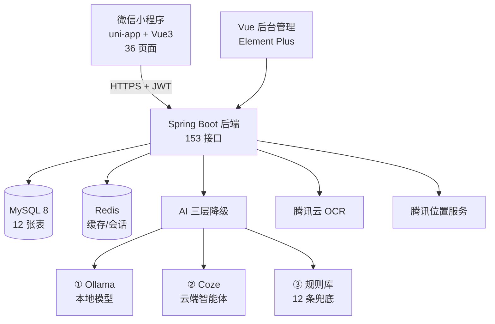

# 赛道二 · 准备材料清单

> **两条线并行**：WorkBuddy 负责跑项目产出材料，你负责截图、路演、账号等需要人操作的部分。
> 截止：**2026-11-18**（今天 11-15，剩 3 天）
> 生成日期：2026-11-15

---

## 快速查看

| | 谁 | 任务数 | 是否阻塞对方 |
|---|---|---|---|
| **A 部分** | **你手动做** | 12 项 | 🔴 有 4 项阻塞 WorkBuddy |
| **B 部分** | **WorkBuddy 做** | 10 项 | 部分等 A 的产出 |

---

# A 部分 · 你手动做的（12 项）

## 🔴 阻塞级（不做 WorkBuddy 动不了）

### A1. 密钥轮换 —— 6 类

**为什么最急**：代码里已清理，但历史密钥仍有效。仓库要公开，泄露即违规。

| # | 密钥 | 去哪操作 | 备注 |
|---|---|---|---|
| 1 | **Coze API Token × 3** | https://www.coze.cn → 个人设置 → API Token | **最急**，可消耗你的额度 |
| 2 | **微信 AppSecret** | mp.weixin.qq.com → 开发管理 → 开发设置 → 重置 | 会重新生成 |
| 3 | **JWT_SECRET** | 本地生成 | `python -c "import secrets; print(secrets.token_hex(32))"` |
| 4 | **腾讯位置服务 Key** | https://lbs.qq.com/dev/console/key/manage | 删旧建新 |
| 5 | **高德地图 Key × 2** | https://console.amap.com | 历史审计里提到泄露 |
| 6 | **MySQL 密码** | 本地 MySQL | `ALTER USER 'root'@'localhost' IDENTIFIED BY '新密码';` |

**产出**：一份新密钥清单（自己保存，**不要提交进仓库**）

**预计**：40 分钟

---

### A2. 填 `.env` 并验证能启动

```powershell
cd "D:\msr150174\项目\智能无感\转换-Java后端\guardian-server"
cp .env.example .env
# 用 A1 的新密钥填进去
.\start.bat
```

**成功标志**：控制台输出

```
============================================================
                   STARTED OK
============================================================
   status : UP
   mysql  : True  (12 tables)
   redis  : True
   ai     : rule  (fallback: rule)
```

**注意**：`application.yml` 的默认值已被我清空，**不配置环境变量会启动失败**，这是有意的安全设计。

**预计**：20 分钟

---

### A3. 提交小程序审核（**唯一真正卡时间的事**）

**为什么急**：审核有周期，被驳回要改再审，来回可能好几天。**今天不提交，就可能来不及**。

| 步骤 | 说明 |
|---|---|
| 1. 确认类目 | **个人主体走"工具 > 效率"或"生活服务"**，不要选"医疗健康" |
| 2. 检查描述文案 | 避开"诊断""治疗""医疗""病症"，改用"健康记录""生活提醒""状态监测" |
| 3. 上传代码 | 开发者工具 → 上传 → 填版本号与备注 |
| 4. 提交审核 | 后台 → 版本管理 → 提交审核 |
| 5. 设为体验版 | 审核通过后设为体验版 |

> ⚠️ 如果被驳回，**按驳回原因改，别硬刚**。健康类功能在个人主体上容易被卡。

**产出**：审核通过截图 + 体验版二维码

**预计**：提交 20 分钟 + 等待审核（不可控）

---

### A4. 授权 WorkBuddy 的仓库访问

**它需要**：项目源码、材料库的读写权限。

| 需要给它的 | 说明 |
|---|---|
| 仓库地址 | 你的 WorkBuddy 云端仓库 |
| 认证方式 | Token 还是 SSH？ |
| 读写权限 | 能否推送 |

**预计**：10 分钟

---

## 🟡 重要级（不影响 WorkBuddy 开工，但影响交付）

### A5. 提供团队 3 人信息

| 项 | 用在哪 |
|---|---|
| 3 人姓名 | 文档封面、README"团队信息" |
| 学校全称 | 同上 |
| 专业 / 年级 | 同上 |
| 分工（如：后端 / 前端 / 文档） | 文档"项目说明" |

**预计**：5 分钟

---

### A6. 提供学校所在省份

**为什么重要**：赛道二按**赛区**评奖（北部 / 东部 / 南部 / 西部 / 港澳台 / 境外）。省份决定赛区。

**预计**：1 分钟

---

### A7. 确认是否投递过其他比赛

f 项当前写的是"**非往届参赛作品**"。

| 情况 | 要怎么做 |
|---|---|
| 从未投过 | 保持现状即可 |
| 投过其他比赛 | **告诉我**，需要在 f 项补一段说明 |

> ⚠️ 赛题违规条款含"作品涉嫌抄袭"，隐瞒比主动说明风险大。

**预计**：5 分钟

---

### A8. 截图（20 张）—— **你的专属任务**

**为什么你来**：需要登录、操作、判断哪些界面有代表性。WorkBuddy 跑不了 UI。

**规格文件**：`05-截图与测试记录规格.md`

| 分组 | 张数 | 内容 |
|---|---|---|
| A 登录注册 | 3 | 验证码登录、微信登录、注册 |
| B 节律守护 | 4 | **首页打卡（主视觉）**、睡眠评分、健康报告、睡眠分析 |
| C 安全守护 | 4 | **SOS 长按界面**、紧急求助地图、告警历史、设备状态 |
| D 健康监测 AI | 5 | **AI 对话**、**AI 降级（关键证据）**、语音监测、**跌倒检测**、监测历史 |
| E 个人中心 | 3 | 用药提醒、家庭成员、**长辈极简模式（大字对比）** |
| F 后台管理 | 1 | Dashboard |

**存到**：`参赛材料库/02-赛道二-AI微信小程序开发/智能无感小程序/截图/`
**命名**：`01-登录.png`、`02-微信登录.png`……

**三个必须拍到的**：
1. **AI 降级对比**（正常回复 vs 断服务后的规则库回复）
2. **SOS 长按 3 秒界面**
3. **大字号模式前后对比**

**预计**：2 小时

---

### A9. 测试记录（20 项）—— **你来执行**

**为什么你来**：需要真实操作、判断结果、如实记录。

**规格文件**：`05-截图与测试记录规格.md` 第三节

**要求**：
- 20 项功能测试，**逐项如实填"实际结果"**
- 失败的写"未通过 + 原因"，**不要编造**
- AI 降级测试单独做，留前后截图
- 兼容性测试至少测 **1 台真机**

**产出**：`测试记录.md`

**预计**：2 小时

---

### A10. 路演 / 答辩准备 —— **你的专属任务**

**为什么你来**：这是人的表达，AI 替代不了。

虽然省赛是"作品题"（不答辩），但：

1. **国赛有现场答辩，占决赛总分 30%**
2. 演示视频的讲解词本质就是路演稿

**建议准备**（3 分钟口述版 + 8 分钟完整版）：

| 要点 | 内容 |
|---|---|
| **开场钩子** | "独居老人在家摔倒，子女多久能知道？" |
| 痛点 | 1 亿独居老人、子女异地、老人不会用 App |
| 方案 | 老人端极简 + 家属端全面 |
| **技术亮点** | 三层降级：AI 挂了老人也不会看到报错 |
| 差异化 | 跌倒检测、三模态、适老化真实落地 |
| **踩坑故事** | "原代码文案写 3 秒，实际 1 秒——这种误触对老人是灾难" |
| 落地 | 个人主体验证 → 企业主体商用 |

**必背的三个数字**：153 个接口、14 处缺陷修复、三层降级

**预计**：1 小时

---

### A11. 录制演示视频（5–8 分钟）—— **你来录**

**为什么你来**：要有人讲解、操作、控制节奏。WorkBuddy 不能录屏配音。

**脚本**：`06-演示视频脚本.md`（已给秒级分镜）

**三个必须做到**：
1. **前 15 秒上价值**——不放 logo、不放标题页
2. **现场停掉 AI 服务再提问**——展示规则库兜底
3. 提到至少 1 处缺陷修复

**规格**：5–8 分钟 / MP4 / 1080p / 普通话讲解

**预计**：2 小时（含剪辑）

---

### A12. 体验二维码

**来源**：小程序后台 → 设置 → 基本设置 → 小程序码下载
**用途**：ZIP 内 `04-体验二维码.png`，方便评委直接扫码

**预计**：10 分钟

---

# B 部分 · WorkBuddy 做的（10 项）

> 以下都是**基于代码和文档就能产出**的内容，不需要你登录或操作 UI。

## 🔴 优先级 1（做完这些文档才完整）

### B1. 补齐作品说明文档的待填项

**输入**：`01-作品说明文档-七项.md`

**要填的 8 处**：

| 位置 | 内容 | 怎么做 |
|---|---|---|
| **a.6** | 演示录屏片段 | 引用 A11 的视频，注明"见附件 02-演示视频.mp4" |
| **d.1** | 系统架构图 | **用 Mermaid 画**（可渲染），或导出 PNG |
| **d.4** | 关键代码片段（3 段） | 从 `AiService.java` 摘降级逻辑；从 `MonitorController.java` 摘跌倒检测；从 `guardian/index.vue` 摘 SOS 长按 |
| **e.1** | 功能截图 | 引用 A8 的 20 张，写图注 |
| **e.2** | 关键流程演示 | 引用 A11 视频的时间点 |
| **e.4** | 测试记录 | 引用 A9 的 `测试记录.md` |
| **e.4** 兼容性 | 真机型号 | 引用 A9 的结果 |
| **g.5.3** | 单位经济模型 | 若有真实 API 用量则替换，否则保留"估算"标注 |

**产出**：完整无【待填】的文档

---

### B2. 画系统架构图

**能用 Mermaid 直接写在 Markdown 里**，导出时自动渲染：



**产出**：`架构图.md` 或导出的 `架构图.png`

---

### B3. 摘录关键代码片段

**三段的选取标准**（要能体现技术含量）：

| # | 来源 | 摘什么 | 为什么 |
|---|---|---|---|
| 1 | `ai/AiService.java` | `chat()` 方法的三层降级主逻辑 | **核心亮点** |
| 2 | `controller/MonitorController.java` | `fallDetect()` 跌倒检测 | 多模态能力证据 |
| 3 | `pages/guardian/index.vue` | 长按 3 秒实现 | 体现缺陷修复 |

**要求**：每段加一句注释说明「这里解决了什么问题」

---

### B4. 对照赛题逐项检查材料完整性

**做什么**：拿 `01-作品说明文档-七项.md` 对照赛题 a–g 要求，逐项确认无遗漏。

**检查表**：

| 项 | 赛题要求 | 文档里有吗 |
|---|---|---|
| a | 项目说明 + 附演示录屏 | ☐ |
| b | 明确标注微信能力 + 云开发 + AI 能力 | ☐ |
| c | 六维度创新点 | ☐ |
| d | 架构图 + 页面结构 + 前后端协同 + 关键代码 + AI 接入 + 难点 | ☐ |
| e | 截图 + 流程演示 + 运行效果 + 测试记录 | ☐ |
| f | 历史说明（已定稿） | ✅ |
| g | 上线计划 + 用户增长 + 运营 + 商业闭环 + 迭代 | ✅ |

**产出**：检查结论，列出任何遗漏

---

## 🟡 优先级 2（交付物成型）

### B5. 导出 PDF

**输入**：完成后的 `01-作品说明文档-七项.md`

**要求**：
- **加封面页**：作品名、赛道、团队信息、日期
- **加目录**
- 图片完整、表格不溢出
- 建议用 Typora 或 VS Code Markdown PDF 插件

**产出**：`作品说明文档.pdf`

---

### B6. 写体验说明

**内容**：

```markdown
# 体验说明

## 访问方式
- 体验版二维码：见 04-体验二维码.png
- 或搜索小程序名称：XXX

## 测试账号
- 手机号：13800000001
- 验证码：见后端控制台日志（开发模式）
- 备用账号：（若有）

## 30 秒体验路径
1. 扫码进入
2. 登录
3. 首页 → 点击打卡，查看健康分
4. 「智能助手」→ 问"我今天睡眠怎么样"
5. 「居家守护」→ 长按 SOS 3 秒

## 注意事项
- AI 功能依赖后端服务，若不可用会自动降级为规则库回复（三层降级设计）
- 本作品为健康记录工具，不提供医疗诊断
```

**产出**：`03-体验说明.md`

---

### B7. 整理 README（进 ZIP 的版本）

**要求包含**：
- 项目简介
- 核心功能表
- 技术架构（引用 B2 架构图）
- 快速开始（启动步骤）
- **评审演示账号**
- 团队信息
- 许可证

---

### B8. 打包 ZIP

**命名**：`第九届传智杯-AI小程序赛道-AI节律守护智能无感.zip`

**结构**：
```
├── 01-作品说明文档.pdf
├── 02-演示视频.mp4
├── 03-体验说明.md
├── 04-体验二维码.png
├── 05-功能截图/（20 张）
├── 06-源代码/
│   ├── backend/
│   ├── frontend/
│   ├── admin/
│   └── db/
└── README.md
```

**必须排除**：`node_modules`、`dist`、`target`、`_解压预览`、`.env`、`*.tar.gz`

**验证**：解开后检查源码能独立启动

**产出**：≤300MB 的 ZIP

---

## 🟢 优先级 3（有余力再做）

### B9. 补充 API 用量数据

如果有 Coze / Ollama 的真实调用记录，替换 g 项 5.3 节的经济模型估算。

**没有就保持"估算"标注，不要编造。**

---

### B10. 生成差异化对比表

**做什么**：对比与市面产品（如养老小程序、智能手环 App）的差异，放进 c 项创新点。

**依据**：三层降级 + 跌倒检测 + 适老化真实落地。

---

# 依赖关系

```
A1 密钥轮换 ──→ A2 填.env启动 ──→ A8 截图
                              └──→ A9 测试记录

A3 提审 ─────────────────────→ A12 体验二维码
                                      ↓
A5 团队信息 ──┐                    B8 打包
A6 省份    ──┤                        ↑
A7 历史确认 ──┴──→ B1 补文档 ──→ B5 导出PDF ──┘
                    ↓
              B2 架构图 / B3 代码片段 / B4 检查
                    ↓
A11 录视频 ────────→ B8 打包
```

**关键路径**：A1 → A2 → A8/A9 → B1 → B5 → B8

---

# 时间建议

## 今天（11-15）

| 时段 | 你做 | WorkBuddy 做 |
|---|---|---|
| 上午 | **A3 提审**（最急）<br>A1 密钥轮换 | — |
| 下午 | A2 启动验证<br>A5/A6/A7 答复信息 | **B2 架构图**<br>**B3 代码片段** |
| 晚上 | **A8 截图**（20 张） | **B1 补文档**（部分，等截图） |

## 明天（11-16）

| 时段 | 你做 | WorkBuddy 做 |
|---|---|---|
| 上午 | **A9 测试记录**（20 项） | B4 完整性检查 |
| 下午 | **A11 录视频** | **B5 导出 PDF** |
| 晚上 | A10 路演稿 | B6 体验说明 / B7 README |

## 11-17

- 你：A12 体验二维码、核对材料
- WorkBuddy：**B8 打包**、最终检查

## 11-18（截止日）

- **只做检查，不改内容**
- 上传提交

---

# 交付验收总表

## 你交付（6 项）

- [ ] A1+A2：新密钥已配置，后端能启动
- [ ] A3：小程序审核通过，拿到体验版
- [ ] A8：20 张截图齐全，有真实数据
- [ ] A9：20 项测试记录，如实填写
- [ ] A11：5–8 分钟视频，含 AI 降级演示
- [ ] A12：体验二维码图片

## WorkBuddy 交付（6 项）

- [ ] B1+B2+B3：文档无【待填】，含架构图与代码片段
- [ ] B4：完整性检查通过（a–g 齐全）
- [ ] B5：PDF 导出，图片完整
- [ ] B6+B7：体验说明 + README
- [ ] B8：ZIP ≤300MB，命名正确，源码能独立启动
- [ ] B9/B10：（可选）用量数据、对比表

---

# 三个最容易翻车的点

| # | 风险 | 预防 |
|---|---|---|
| 1 | **个人主体类目被拒** | 选"工具>效率"，避开医疗词，**今天提审** |
| 2 | **ZIP 里带 node_modules** | 打包会爆到 1GB+，**必须排除** |
| 3 | **测试记录编造** | 评委追问就崩，**如实写未通过项** |
